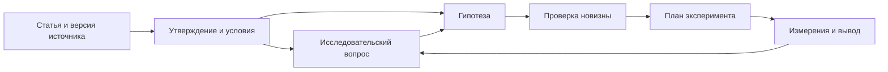

# Science — исследовательская картотека

Разборы публикаций, проверяемые утверждения, исследовательские вопросы, гипотезы и
эксперименты. Рабочий язык — русский; оригинальные названия и идентификаторы сохраняются.

Исходные данные — Markdown + JSON. SQLite, поисковые векторы и Neo4j — восстанавливаемые
проекции. Ядро работает на Python 3.9+ без внешних пакетов. Поиск по смыслу использует
отдельное окружение Python 3.12 и локальную мультиязычную модель.

## Быстрый старт

```sh
git clone https://github.com/xabarov/science.git
cd science
python3 science.py validate
python3 science.py index
python3 science.py search 'MoPPS'
python3 science.py list --topic conditional-computation
python3 science.py related arxiv:2610.39497 --depth 2
python3 science.py show arxiv:2610.39497
```

Поиск возвращает пути к заметкам, открываемым в редакторе или Obsidian.
У search/list есть `--json`, фильтры kind/status/year/topic/method/dataset/epistemic.
Обычный запрос ищет все слова; `--fts` включает фразы, OR, NOT и префиксы:

```sh
python3 science.py search 'предиктор* OR predictor*' --fts
```

## Исследовательская работа

```sh
python3 science.py note question my-question --title 'Исследовательский вопрос'
python3 science.py note idea my-hypothesis --title 'Проверяемая гипотеза'
python3 science.py note experiment my-test --title 'Минимальный эксперимент'
python3 science.py research-list
python3 science.py claim 'arxiv:2610.39497#c3'
python3 science.py compare --group mopps-v2-table1-r1distill1.5b-aime24
python3 science.py novelty --id idea:domain-shift-audit
python3 science.py impact 'arxiv:2610.39497#c3'
python3 science.py review-queue
```

Для новой статьи: `python3 science.py new ARXIV_ID_OR_DOI --title 'Название'`.
Заготовка inbox не считается разбором. Заполнять record.json и review.md,
затем `validate`, `index`, `check`. Обычный поиск читает последний успешный индекс.



Связи поддерживают адреса `document#claim`. Зависимости пересматриваются при изменении
основания; научные выводы не меняются автоматически. В источниках и наших идеях
различаются экспериментальные сообщения, теоретические результаты и гипотезы.

## Поиск по смыслу

```sh
uv venv --python python3.12 .venv
uv pip install --python .venv/bin/python -r requirements-semantic.txt
.venv/bin/python science.py semantic-index
.venv/bin/python science.py semantic-search 'как обнаружить уверенные ошибки в новом домене' --limit 5
.venv/bin/python science.py semantic-search 'predictive prompt selection' --hybrid
.venv/bin/python science.py eval-search --k 3
```

С `semantic-index --with-sources` индексируются также локальные снимки первоисточников.
Тексты кодируются локально; первое использование скачивает веса. Веса и векторы
в Git не хранятся. При изменении карточек семантический индекс требует пересборки.
[Устройство и ограничения](docs/semantic-search.md), [протокол оценки](docs/search-evaluation.json).

## Хранение

```text
papers/<year>/<id>/record.json + review.md
notes/topics/          Карты направлений
notes/questions/       Исследовательские вопросы
notes/ideas/           Гипотезы и проверка новизны
notes/experiments/     Протоколы, измерения, исходы
notes/syntheses/       Сопоставления работ
sources/manifest.json Версии, URL и хеши снимков
attachments/          Локальные первоисточники; вне Git
vocab.json            Темы, методы, датасеты и синонимы
research.py           Утверждения, измерения, стадии и пересмотр
preservation.py       Снимки, архивы и восстановление
semantic.py           Локальные embeddings и оценка поиска
science.py            CLI, SQLite и экспорт графа
```

SQLite и кэши находятся в data/, выгрузки — в exports/; всё восстанавливается.
Версии одной работы объединяются стабильным ID и aliases. У каждой карточки есть
reading_scope: abstract/partial/full; source_checked не означает воспроизведения.

## Первые исследования

- [Обсуждавшаяся концептуальная работа](papers/2026/arxiv-2610.39497/review.md).
- [Часть экспериментов MoPPS](papers/2025/arxiv-2507.04632/review.md).
- [Вопрос об аудите при смене домена](notes/questions/question-auditing-under-shift/review.md).
- [Гипотеза и первичный поиск новизны](notes/ideas/idea-domain-shift-audit/review.md).
- [План эксперимента — пока не выполнен](notes/experiments/experiment-auditing-replay/review.md).

## Сохранность и проверки

```sh
python3 science.py check-sources
python3 science.py backup --destination /path/outside/repository
python3 science.py export-neo4j
python3 -m unittest discover -s tests -v
```

GitHub хранит код и записи. Снимки статей не публикуются; архивы резервируют их
вместе с записями и Git-историей. На исходном Mac установлен ежедневный backup в
23:30; установка на другом Mac — через install_backup.py. Локальный архив на том
же диске не защищает от потери диска; для вложений нужен отдельный носитель.
Полного сервера Neo4j и автоматического ежедневного чтения статей нет.

Документация: [процесс](docs/workflow.md), [формат](docs/format.md),
[исследовательский слой](docs/research.md), [архитектура](docs/architecture.md),
[резервирование](docs/preservation.md), [Neo4j](docs/neo4j.md).
Проверки формата и кода запускаются GitHub Actions при push/PR.
