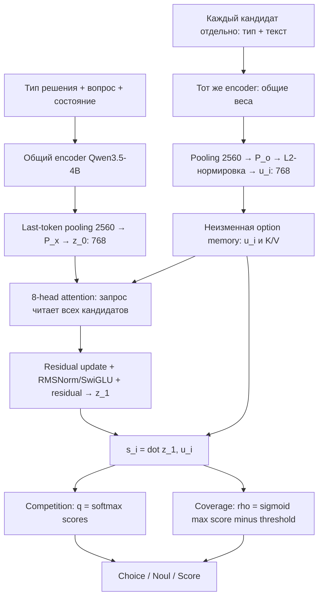

# Jeva: System One Models from First Principles

ID: `arxiv:2610.18773`. Разбор от 2026-11-03.
[Статья v2](https://arxiv.org/html/2610.18773v2),
[код](https://github.com/LiQiiiii/Jeva),
[Jeva-4B](https://huggingface.co/LIQIIIII/Jeva-4B).

## Глубина проверки

Прочитаны основной текст, таблицы 1–2, выбранные доказательства симметрии,
переиспользования и loss, приложения B.5–B.8 и C. Формулы сверены с model.py и
matrix_decision.py на commit `e2104e0720100f979f2cdd456a1cbbee96da0abd`.
Проверены config.yaml, metadata.json и adapter_config.json HF revision
`25ca454b3522615a243c06703ba410ecf152a128`. Полного аудита доказательств, данных и
воспроизведения inference/training не было. `reading_scope=partial`.
Снимки статьи, decision-core и README сохранены локально с хешами.

## О чём работа

Jeva выдаёт компактное типизированное решение: выбрать кандидата, оценить
вероятность истинности условия или численную оценку по рубрике. Модель не генерирует
объяснение токен за токеном. Её четыре цели — распознавать отсутствие допустимого
кандидата, сохранять решение при перестановке вариантов, поддерживать переменное
число вариантов и переиспользовать вычисления по повторяющимся кандидатам.

Ключевая архитектурная идея: независимо закодировать запрос и варианты, затем
уточнить только вектор запроса по всему набору вариантов. Представление каждого
варианта остаётся независимым от текущего вопроса, но окончательное решение
зависит от состава набора (Sections 3.1–3.2).

## Архитектура: поток данных



Схема — наше изложение Figure 1 и Sections 3.1–3.4. Это один небольшой блок решения
поверх полного языкового encoder, а не однослойная модель целиком.

### 1. Независимое кодирование

Вход запроса содержит тип (`choice`, `noul`, `score`), вопрос и состояние. Вход
кандидата содержит только тип и текст кандидата. Индекс варианта, текущий вопрос,
состояние и другие кандидаты в его текст не добавляются (Appendix C.6).

Общий encoder E обрабатывает каждый текст независимо. Берётся hidden state
последнего непустого токена. Две разные обучаемые проекции дают:

- `z_0 = P_x E(request)` — вектор запроса;
- `u_i = L2_normalize(P_o E(option_i))` — вектор кандидата.

В Jeva-4B размерность encoder-выхода 2560, обе проекции дают 768. Нормировка
кандидата обязательна, но начальный и конечный векторы запроса не нормируются до
единичной длины: их масштаб сохраняет информацию для оценки уверенности.

Общие веса encoder не означают совместное кодирование всех текстов. Несколько
независимых текстов можно обработать батчем без их взаимного attention.

### Конкретные строки на входе encoder

В Python API `state` задаёт данные случая, `Choice.instructions` — вопрос, а класс
`Choice` определяет тип `choice`. Имена вопросов и ключи criteria используются
как идентификаторы интерфейса. Encoder получает токенизированный обычный текст:

```text
Decision type: choice
Question: Which team should handle this?
State:
I was charged twice.
```

Каждый вариант является отдельной последовательностью:

```text
Option for choice: Billing
```

```text
Option for choice: Technical support
```

```text
Option for choice: Delivery
```

Список кандидатов не включается в строку запроса. Для этого примера encoder
обрабатывает четыре независимые последовательности; варианты можно объединить
в батч с padding/attention_mask. После pooling получаются один request vector
и три option vectors. Реальный низкоуровневый вход нейросети — input_ids и
attention_mask, а не JSON-строка. Шаблоны сверены с `state_question_text` и
`option_text` в [collate.py](https://github.com/LiQiiiii/Jeva/blob/e2104e0720100f979f2cdd456a1cbbee96da0abd/src/jeva/_runtime/collate.py).

### Что является encoder: TextBackbone и авторегрессионная LLM

`TextBackbone` — обёртка, а фактическая нейросеть внутри Jeva-4B — текстовая часть
Qwen3.5-4B с LoRA. `AutoModel.from_pretrained` загружает тело модели; для Qwen3.5
код выбирает `language_model` напрямую либо сохраняет wrapper, если этого требует
иерархия сохранённого адаптера. Это техническая совместимость загрузки, а не другая
семантика кодирования.

Qwen остаётся decoder-style каузальной языковой моделью; Jeva не заменяет её на BERT
и не делает attention двунаправленным. Слово encoder описывает роль: отображение
готового текста в вектор. Последнее непустое положение видит весь предшествующий
ввод через каузальные слои, поэтому его hidden state используют для pooling.

Вызов `self.model(**inputs)` возвращает `last_hidden_state` формы `[B,T,2560]`.
`encode()` выбирает последнее непустое положение и получает `[B,2560]`.
Далее проекция Jeva даёт `[B,768]`. LM vocabulary head и цикл `.generate()` в
вычислении решений не используются. `TaskType.FEATURE_EXTRACTION` у LoRA задаёт
способ использования/обёртку, но не превращает каузальную модель в BERT-encoder.

Код: [backbone.py](https://github.com/LiQiiiii/Jeva/blob/e2104e0720100f979f2cdd456a1cbbee96da0abd/src/jeva/_runtime/backbone.py),
[конфигурация Qwen3.5-4B](https://huggingface.co/Qwen/Qwen3.5-4B/blob/main/config.json).
Текстовая конфигурация содержит 32 слоя и hidden size 2560, сочетая linear attention
с full attention; обе формы используются в каузальной языковой модели.

### 2. Память вариантов и attention

Из каждого u_i строятся ключ и значение для каждой головы. Из z строится query.
Query и key каждой головы L2-нормируются; values — линейно спроецированные u_i.
Вес кандидата в голове:

`a_i = softmax_i(dot(query, key_i) / tau_set)`.

Сообщение — взвешенная сумма values, результаты голов объединяются и проходят
выходную проекцию W_O. Затем:

`z_tilde = z + alpha * message`

`z_next = z_tilde + (1/sqrt(L)) * SwiGLU(RMSNorm(z_tilde))`.

Температура положительная и обучаемая; `alpha = tau_set * sigmoid(gamma)/sqrt(L)`.
Вектора кандидатов и их K/V при этом не обновляются. В опубликованном Jeva-4B
L=1, восемь голов по 96 компонент, SwiGLU hidden width 3072. Архитектура допускает
больше блоков, каждый из которых вновь читает ту же неизменную память.

Это attention одного вектора запроса к K кандидатам, без матрицы взаимодействий
K×K между кандидатами. При готовых K/V стоимость head линейна по K при фиксированных
размерах; полный inference также оплачивает encoder для запроса и новых вариантов.

### 3. Почему это богаче независимого cosine retrieval

Если независимо вычислять score(request, option), добавление третьего варианта
не меняет относительное предпочтение между первым и вторым. В Jeva третий вариант
меняет attention-сообщение и z_1, поэтому порядок первых двух может измениться.
Proposition 1 даёт явную конструкцию с одним блоком. Это доказательство
выразительности архитектуры, а не гарантия, что любое такое изменение полезно.

При перестановке тех же вариантов взвешенная сумма сохраняется, а вероятности
переставляются вместе с кандидатами. При изменении состава или кратности вариантов
состояние может измениться. Эти два свойства совместимы.

### 4. Readout: конкуренция и наличие ответа

Общий scorer применяется ко всем вариантам: `s_i = dot(z_1, u_i)`.
Нового параметра класса при добавлении кандидата не требуется.

Competition даёт условное распределение `q_i = softmax(s_i / tau_dec)`.
Coverage отдельно оценивает наличие хотя бы одного допустимого варианта:

`rho = sigmoid((max_i(s_i) - b_cov) / tau_cov)`.

Для open-set ответа: `p_null = 1-rho`, `p_i = rho*q_i`. Для closed-set используется q.
Нулевой исход не кодируется как ещё один текстовый кандидат. Например, все варианты
могут быть одинаково плохими, но softmax всё равно назначит одному из них наибольшую
условную вероятность; coverage добавляет отдельную оценку наличия ответа.

Максимум вместо logsumexp убирает обязательную зависимость coverage от количества
одинаковых scores. Однако реальные scores меняются после уточнения z, а argmax по
`p_null,p_1,...,p_K` зависит также от конкуренции. Нельзя заключать, что добавление
кандидатов никогда не изменит null-решение (Section 3.3; Appendix A.3/B.4).

### 5. Три типа выхода

| Тип | Что читается из модели |
| --- | --- |
| Choice | Распределение/выбор кандидата; при allow_null также null |
| Noul | Вероятность положительного Boolean-кандидата в q |
| Score | Ожидание `sum_i q_i * rubric_value_i` |

Noul и null имеют разные значения. В Noul варианты могут быть `false/true`, а выход
— вероятность `true`. У Score численные значения задают шкалу интерпретации, а не
добавляются отдельным полем в encoder-вход. Например, вероятности уровней Low,
Medium, High с values 0,1,2 дают `score = q_Medium + 2*q_High`.

## Обучение

Опубликованная модель использует Qwen3.5-4B с LoRA rank 64, alpha 128; дополнительно
обучаются обе проекции и decision core. Их 13,370,117 параметров не включают полный
backbone и LoRA-параметры. HF checkpoint включает backbone, adapter и head; адаптер
можно объединить с backbone для serving.

Основной open-set loss: BCE для наличия кандидата плюс cross-entropy условного
распределения. Он эквивалентен joint cross-entropy на p. В основном loss all-null
примеры обучают coverage, не навязывая фиктивное ранжирование кандидатов.
Для Noul/Score описаны дополнительные losses; обучение — supervised AdamW, не RL.

Многостадийный curriculum включает typed decisions, intents, verification,
reading/reasoning и большие наборы кандидатов, hard/soft targets и replay.
Описанные объёмы стадий включают повторные данные: их сумма не является числом
уникальных обучающих примеров (Section 3.5; Appendix B.8/C.1).

## Кэш и реальная скорость

Atomic memory содержит `u_i` и все слои K_i/V_i. Exact-set cache хранит готовую
сборку набора; hybrid также переиспользует отдельных кандидатов в новых наборах.
Для нового запроса всегда пересчитываются его encoder-вектор, уточнение z и выход.
Ответы не кэшируются. Идентичность включает веса, tokenizer, тип, template, length
policy и численную конфигурацию. После дообучения старые записи нужно инвалидировать.

| Проверка авторов | Результат и условия |
| --- | --- |
| 600 Choice-примеров, несколько порядков | 0% flips; all-order accuracy 76.67%, то есть стабильность не равна правильности |
| BANKING77, K=16, 3 080 запросов, 588 без ответа | null AUROC 98.66%; TPR 93.88% при FPR 5.02% |
| Typed Decisions, 2 000 примеров | Jeva 78.30%, InternDecision-4B 78.70% |
| ToolRet, K=2048, H200 | Jeva accuracy 69.88%, p50 12.040 s; recursive JevK5 67.47%, 28 s |
| MLDR, новый набор с полным reuse, H200 | p50 2102.0 → 75.1 ms; priming не включён |

Источники: Tables 1–2, Sections 4.1–4.4. Полное ускорение MLDR относится к наличию
готовой памяти длинных кандидатов. На новых длинных вариантах encoder остаётся
дорогим. Скорость также сильно зависит от batching: именно его изменение снизило
latency Jeva при K=2048 с 94.459 до 12.040 s; это отдельный эффект от кэша.

Есть несогласованность протокола v2: Section 4.4/Figure 9 говорят о 50 novel-set
запросах на уровень reuse, Appendix C.5 — о 46. Уточнение авторов/логов не получено.
В cache-study решений не изменилось, но абсолютная разница вероятностей доходила
до 0.00736. Теорема об exact reuse относится к одинаковым входам и точной арифметике;
реальные batching и reductions требуют численных допусков.

## Ограничения и связь с картотекой

- Single-vector pooling сжимает весь текст кандидата. Гипотеза о потере мелких
  деталей длинного документа требует отдельной проверки; опубликованные результаты
  не закрывают все виды документных задач.
- Устойчивость к перестановке требует переставлять текст и metadata согласованно.
  При равных максимумах first-argmax может выбрать другой tied элемент; для
  идентичного выбора нужна политика разрешения ties.
- Null означает отсутствие допустимого варианта среди предоставленных, а не
  гарантированное распознавание незнания модели. OOD-калибровка и уверенные ошибки
  сохраняют актуальность [вопроса об аудите](../../../notes/questions/question-auditing-under-shift/review.md).
- ToolRet включает дополнительные weak/unjudged negatives и multi-positive задачи;
  baselines имеют разные интерфейсы и обучающие данные. Это не чистая абляция одной
  архитектуры при одинаковом обучении.

Для [System-1/System-2 perspective](../arxiv-2610.39497/review.md) Jeva — конкретный
вариант быстрого решателя/селектора. Обучение предиктивному распределению дорогих
вычислений в той perspective отдельно здесь не воспроизводится.

Jeva не использует BGE-M3 embeddings из нашей Qdrant-базы: её вектора получаются
собственным encoder и обученными проекциями. Возможный исследовательский pipeline:
Qdrant получает небольшой список кандидатов, Jeva делает set-conditioned выбор,
после чего дорогая LLM выполняет выбранное действие. Такой pipeline у нас не внедрён,
преимущество и новизна комбинации не проверены. Для проверки нужны равный бюджет,
reranker baseline, качество under OOD и аудит отвергнутых кандидатов.

## Следующие проверки

Воспроизвести параметризацию и cache agreement на малом наборе, затем отдельно
измерить cold/warm latency, качество на длинных кандидатах и OOD false-accept rate.
Подготовить проверку устойчивости к дубликатам и добавлению отвлекающих вариантов:
перестановочная симметрия не гарантирует инвариантность к изменению множества.
